# ShadowBox

**A boxing game you play with your body.** Stand in front of a webcam, throw
real punches, slip and duck real punches. The browser tracks your pose and
turns it into a first-person fight. No controller, no wearables, no install.

**Play it:** https://throwdown-orcin.vercel.app (Chrome or Safari, a webcam,
and some room to move).

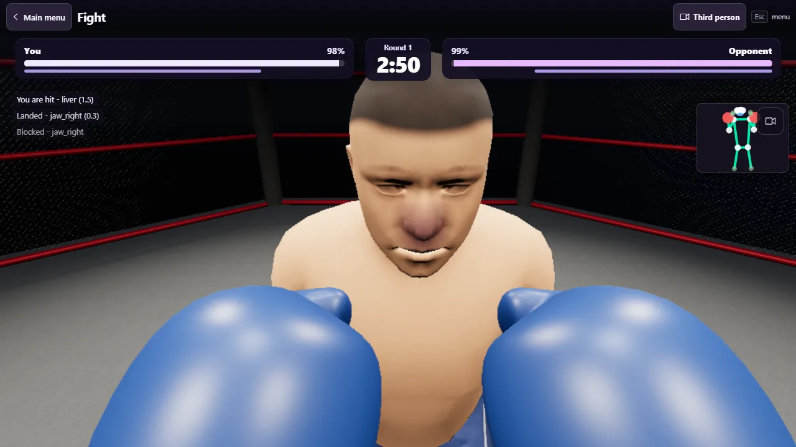

Everything that touches your camera runs in your browser. Video never leaves
the machine. In a two-player fight only your pose landmarks (about 5 KB/s) go
directly to your opponent, peer to peer.

---

## Screens

| | |
| --- | --- |
| 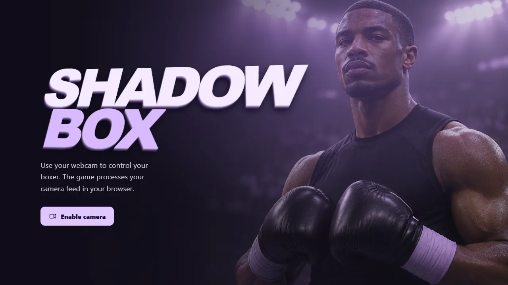 | 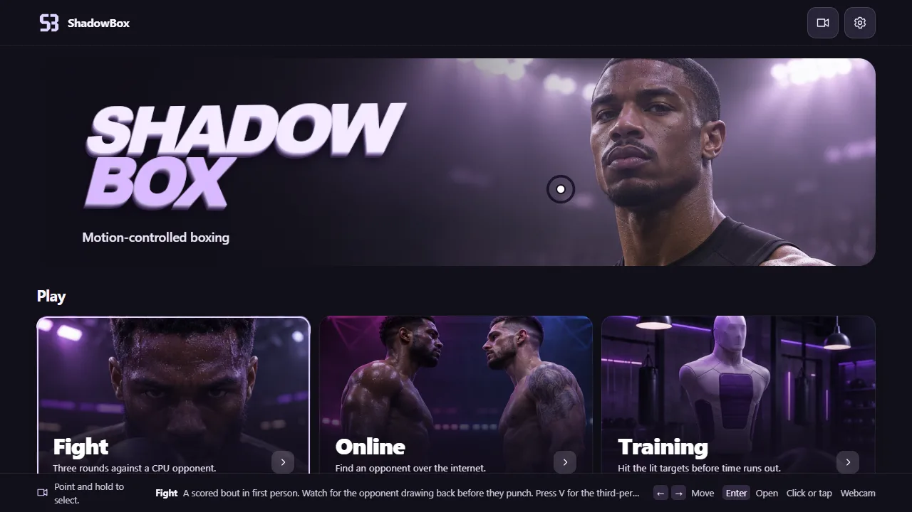 |
| **Start.** One tap to enable the camera; everything after is driven by your body. | **Menu.** Three primary modes and the rest one tap away. Point and hold your hand to select. |
| 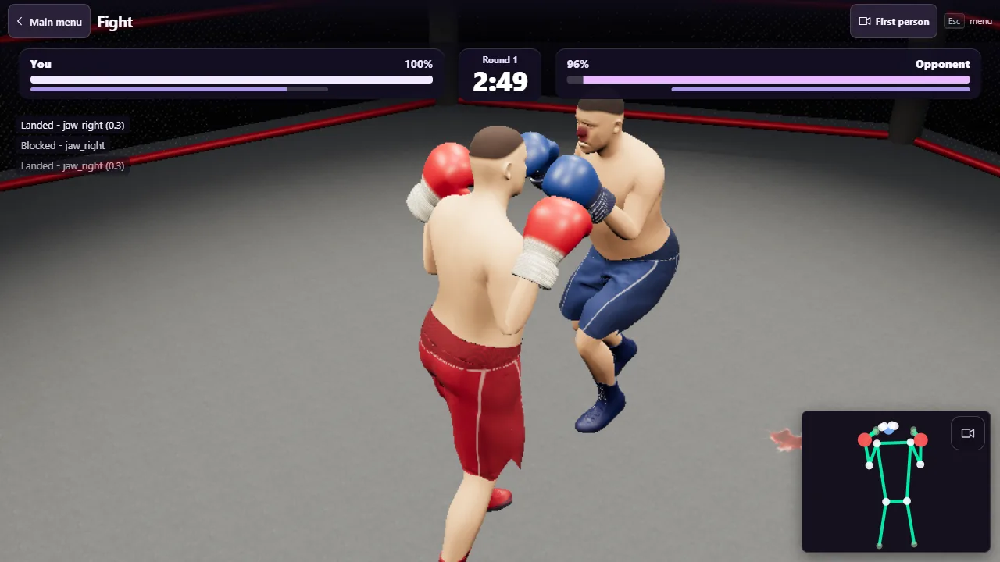 |  |
| **Third person.** Pick first or third person before each match; `V` switches mid-fight. | **Training.** Lit targets on a dummy, scored on accuracy, power and timing. |
| 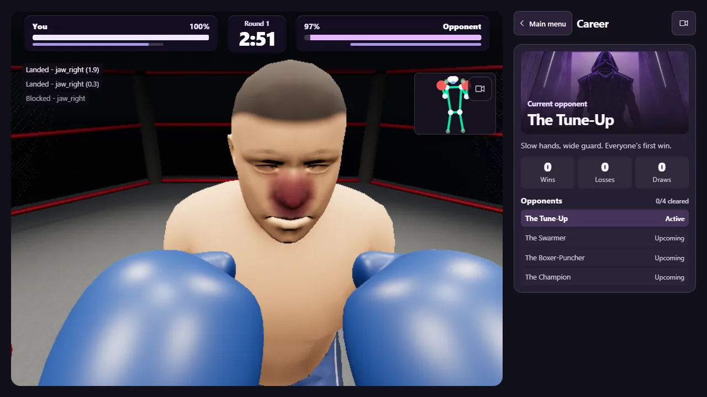 | 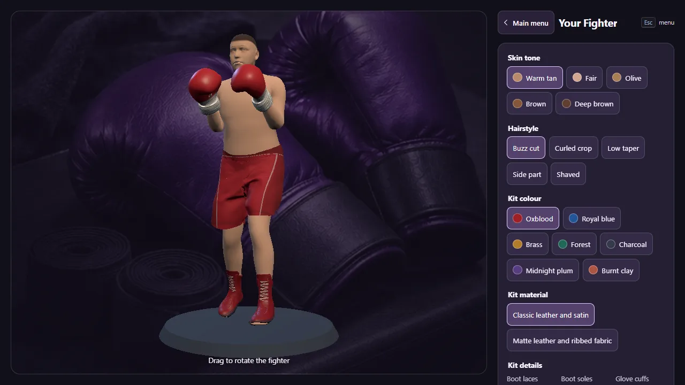 |
| **Career.** Four opponents in order; your record is saved on the device. | **Your Fighter.** Skin, hair, kit colour, finish, laces, soles and wraps. |
| 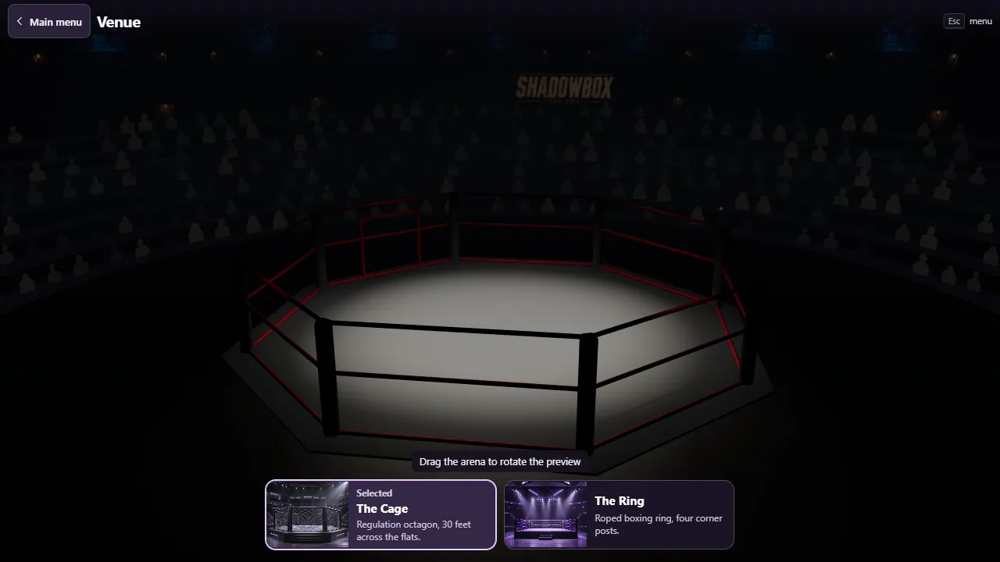 | 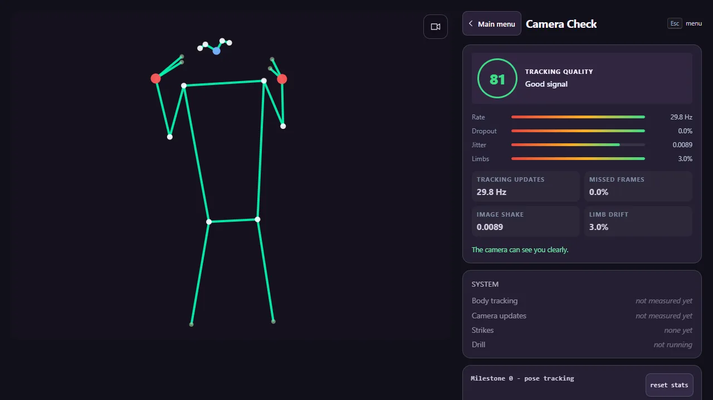 |
| **Venue.** A regulation octagon or a championship ring, both procedural. | **Camera Check.** Live tracking quality and tips, skeleton only unless you turn your camera on. |

Two players, the host and the guest, each in their own first-person view:

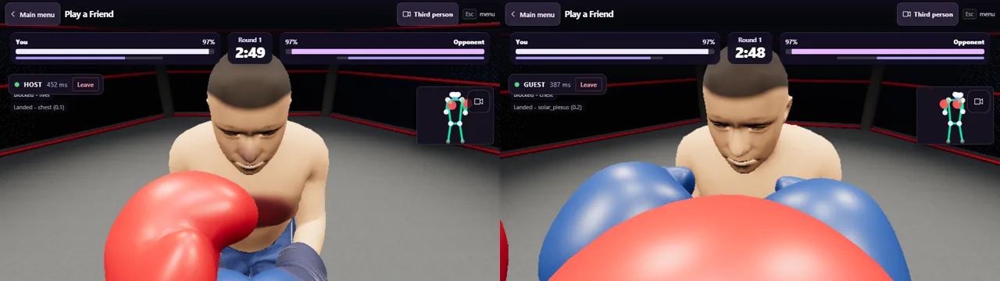

A CPU punch, frame by frame: off the guard, across, landing, back. The hit
registers as the glove arrives.

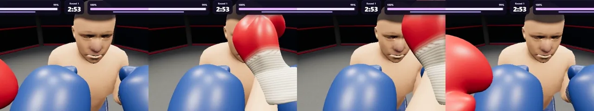

On a phone the game runs edge to edge:

| | | | | |
| --- | --- | --- | --- | --- |
| 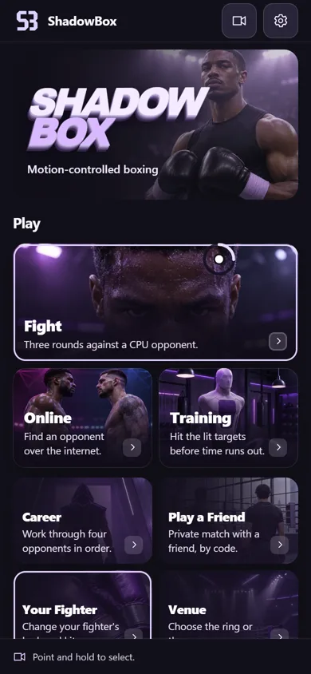 | 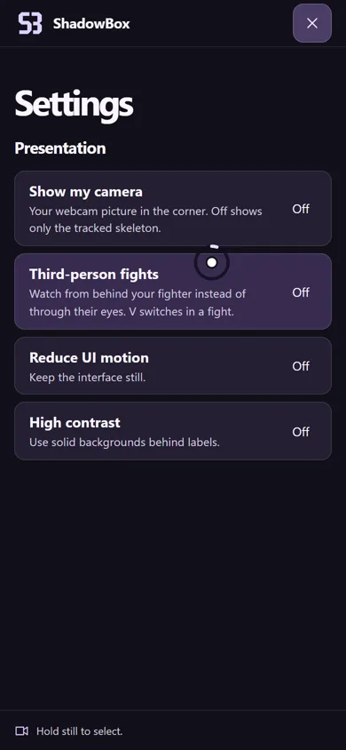 | 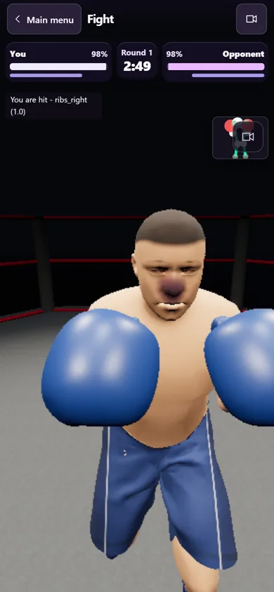 | 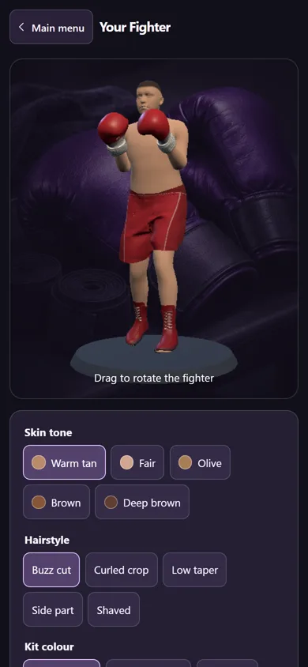 | 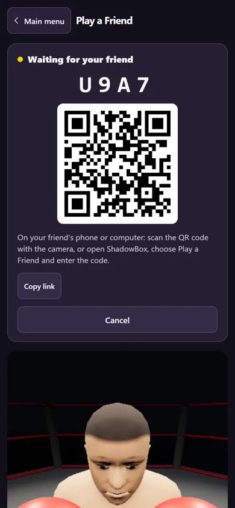 |

---

## Features

- **First-person boxing.** The camera sits at your fighter's eyes; your gloves
  are at the bottom of the frame and the opponent is in front of you.
- **Full-body tracking from one webcam.** MediaPipe pose, cropped to you,
  constrained, smoothed and predicted forward, at up to the camera's frame
  rate. Punches, slips, ducks, the guard and steps all come from your body.
- **A CPU opponent that boxes.** Separate attack, footwork and head-movement
  state machines, a visible wind-up before every punch, punches thrown with the
  shoulders, slips that beat straights but not hooks.
- **Two-player fights.** Online matchmaking, or a friend joins with a
  four-character code or by scanning a QR code. The guest's
  defence counts, both ends see the same result, and a rematch keeps the link.
- **Career and training.** Four-opponent career, a learning target drill that
  separates camera setup error from technique.
- **Real sounds.** Recorded punches, blocks, whiffs, bell and crowd from
  Openverse (CC0 and CC BY), with a synthesised fallback.
- **Your look.** Fighter customisation with live 3D preview.
- **Privacy by default.** The corner inset shows only your tracked skeleton
  unless you choose to show your camera.

Full list of modes, controls and rules: [`docs/GAMEPLAY.md`](docs/GAMEPLAY.md).

---

## Getting started

```bash
npm install
npm run dev          # http://localhost:5174
```

For online "Find a match" locally, also run the server (needs the .NET 11 SDK):

```bash
dotnet run --project server/Throwdown.Server   # http://localhost:5160
```

| Command | What it does |
| --- | --- |
| `npm run dev` | Dev server. |
| `npm run build` | Type-check and build. |
| `npm test` | Web unit tests (Vitest, 775). |
| `npm run lint` | oxlint. |
| `dotnet test server/Throwdown.slnx` | Server tests (xUnit). |
| `npm run smoke` | Builds, then drives the real app in headless Chrome with a fake camera. |
| `node tools/smoke-versus.mjs [s]` | Two browsers, one fight: defence, events, clock sync and rematch. |
| `node tools/screenshots.mjs` | Regenerates every screenshot in this README. |
| `node tools/fight-burst.mjs [mode] [video]` | Screenshots a live fight. |
| `node tools/perf-ab.mjs [s] [n] [query...]` | A/B timings: pose rate, render fps, long tasks. |
| `node tools/fake-player.mjs` | Renders the boxer throwing punches into a video Chrome uses as a fake camera. |

The browser tools need `npm run preview` in another terminal. `?mode=<id>`
opens a mode directly (`cpu`, `career`, `internet`, `lan`, `dummy`, `fighter`,
`stages`, `tracking`) and `?view=third` starts fights in third person.

---

## How it is built

```
 webcam ──> MediaPipe PoseLandmarker ──> crop · constrain · smooth · predict
                                              │
             ┌────────────────────────────────┼─────────────────────────┐
             ▼                                ▼                         ▼
     strike resolver                  body channels              rig retargeting
   (reach, zone, power)        (slip, duck, guard, step)       (MHR fighter, IK)
             │                                │                         │
             └──────────────> fight sim <─────┘                         │
                       (health, stamina, rounds, CPU)                   │
                                 │                                      ▼
                                 ├──> HUD (React)              three.js scene
                                 ├──> audio (WebAudio)     (first-person camera,
                                 └──> peer link (WebRTC) ──>  venue, crowd)
```

| Layer | Technology |
| --- | --- |
| Pose tracking | `@mediapipe/tasks-vision` PoseLandmarker (lite), GPU delegate with CPU fallback, WASM served from `public/` |
| Game client | TypeScript 6, React 19, Vite 8 (rolldown) |
| 3D | three.js r185, procedural venues, instanced crowd |
| Character | Meta MHR body model (Apache-2.0), exported offline via FBX2glTF, kit authored in Blender |
| UI | React components, React Bits Spotlight Card (vendored), CSS with safe-area and reduced-motion support |
| Multiplayer | WebRTC data channels, peer to peer; host-authoritative fight |
| Server | C# on .NET 11: ASP.NET Core, SignalR matchmaking, minimal APIs, Npgsql (Supabase Postgres), OpenTelemetry, xUnit |
| Audio | WebAudio, recorded samples from Openverse, synthesised fallback |
| Hosting | Vercel (game), Render (server, Docker) |
| Quality | Vitest, Playwright end-to-end with a fake camera, oxlint, GitHub Actions |

Deep dive: [`docs/TECHNOLOGY.md`](docs/TECHNOLOGY.md). How the game was built,
phase by phase: [`docs/DEVELOPMENT.md`](docs/DEVELOPMENT.md).

---

## Ground rules

- Perception never reads the character mesh. What you hit does not depend on
  how you are drawn.
- MediaPipe `z` is never read for classification.
- No threshold that decides whether a punch landed may be auto-tuned.
- Video never crosses the network. Pose landmarks do, peer to peer, only to an
  opponent you chose and only while a fight is open.
- Licence-clean only: no copyleft models, no ripped game assets.

These are enforced by tests, not convention.

---

## Status

**Working:** first-person and third-person fights against the CPU, career,
training, the camera-driven menu, both venues, fighter customisation, damage
and knockdowns, two-player fights with defence, shared results and rematch
(verified by two real browsers), online matchmaking through the deployed
server.

**Not done:** punch *type* is not classified from a front camera; hits are
judged by reach and zone instead. No TURN relay is running, so some online
pairings behind strict NATs will not connect. The leaderboard is reported by
the browser, so it is not cheat-proof.

**Not verified:** real phones and live hand tracking on physical devices; the
end-to-end tests use Chrome with a fake camera.

---

## Documentation

| | |
| --- | --- |
| [`docs/GAMEPLAY.md`](docs/GAMEPLAY.md) | Modes, controls, rules, scoring, settings. |
| [`docs/TECHNOLOGY.md`](docs/TECHNOLOGY.md) | Tracking, character, rendering, fight sim, CPU, netcode, audio, server, measurements. |
| [`docs/DEVELOPMENT.md`](docs/DEVELOPMENT.md) | Development phases, the Claude and Codex workflow, testing tools, what is next. |
| [`docs/ARCHITECTURE.md`](docs/ARCHITECTURE.md) | Principles and module boundaries. |
| [`docs/ASSET-PIPELINE.md`](docs/ASSET-PIPELINE.md) | How the fighter mesh is made. |
| [`docs/UI-REVIEW.md`](docs/UI-REVIEW.md) | UI research (FC 27, NBA 2K27, WWE 2K26, UFC 5) and design decisions. |
| [`docs/DEPLOY.md`](docs/DEPLOY.md) | Deploying the game, the server and the database. |
| [`docs/CREDITS.md`](docs/CREDITS.md) | Sounds, libraries and licences. |
