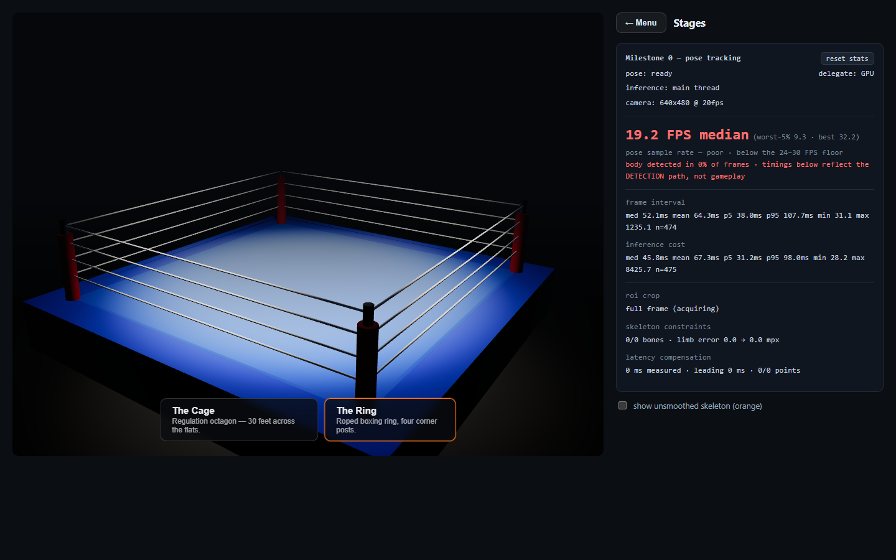

# Shadow Box

**A boxing game you play with your body.** Stand in front of a webcam, throw
real punches, slip and duck real punches. The browser tracks your pose and
turns it into the fight. No controller, no wearables, no install.

Everything runs client-side. Video never leaves the machine. In a two-player
fight your pose landmarks, not the picture, go directly to your opponent.



---

## Getting started

```bash
npm install
npm run dev          # http://localhost:5174
```

For online "Find a match", also run the server (needs the .NET 11 SDK):

```bash
dotnet run --project server/Throwdown.Server   # http://localhost:5160
```

| Command | What it does |
| --- | --- |
| `npm run dev` | Dev server. |
| `npm run build` | Type-check and build. |
| `npm test` | Web unit tests (749). |
| `dotnet test server/Throwdown.slnx` | Server tests (23). |
| `npm run lint` | oxlint. |
| `npm run smoke` | Builds, then drives the real app in headless Chromium with a fake camera. |
| `node tools/smoke-versus.mjs [s]` | Two browsers, one Play a Friend fight: checks defence, events, clock sync and rematch. |
| `node tools/fight-burst.mjs [mode] [video]` | Screenshots a live fight with the fake player as the camera. |
| `node tools/perf-ab.mjs [s] [n] [query...]` | A/B timings during a CPU fight: pose rate, render fps, long tasks. |
| `node tools/fake-player.mjs` | Renders the boxer throwing punches into a video Chrome can use as a fake camera (needs `npm run dev`). |
| `npm run measure:sweep` | Measures the pose pipeline on this machine (needs you in front of the webcam). |

The browser tools need `npm run preview` in another terminal. `?mode=<id>`
opens a mode directly (`cpu`, `career`, `internet`, `lan`, `dummy`, `fighter`,
`stages`, `tracking`) and `?view=third` starts fights in third person.

---

## What it does

### Modes

**Fight** (three rounds against the CPU), **Career** (four opponents in order),
**Online** (matchmaking), **Play a Friend** (private match by code),
**Training** (the scored dummy), **Your Fighter** (look and kit), **Venue**
(ring or cage) and **Camera Check** (what the camera can see).

The menu is navigated with your body: your hand moves a cursor and holding it
over a card confirms. Keyboard, touch and mouse work too, and Escape always
returns to the menu. A new browser gets a three-step walkthrough (frame, guard,
one punch each hand) that the camera confirms; `?firstrun=0` skips it.

### First person

Fights open with the camera at your fighter's eyes, your gloves at the bottom
of the frame and the opponent in front of you. The head bone is collapsed while
the camera is inside it, so only arms and gloves show. The field of view widens
on portrait screens so the opponent's shoulders stay in frame. Both fighters
hold the neutral gap, so defence is slips, ducks and the guard, and a downed
player gets up early by holding their gloves up. **V** switches to the camera
behind your fighter (and frees the footwork); the choice is remembered.

### The CPU opponent

Three state machines on independent clocks: attack, footwork and head
movement. Every punch has a visible wind-up (down to 260 ms at the hardest
difficulty), and the gloves glow through it in first person. A slip beats a
straight but not a hook; a duck gets under any arc and does nothing about a
body shot. Evading costs stamina. Every random choice is seeded, so a fight is
reproducible.

### Two players

Peer-to-peer over WebRTC, found by matchmaking (Online) or by pasting codes
(Play a Friend). The remote fighter is drawn from their own live pose through
the same retargeting as yours.

The host runs the fight. The guest sends its punches and its guard and head
movement, measured from its own camera, and gets the state and every fight
event back, so both ends see the same result, words and sounds. Because the
guest's defence arrives late, the host holds its own punches at the guest for
one round trip (30-150 ms) and counts a slip or block made inside that window.
When the fight ends, both players asking (button or both hands raised) starts a
rematch on the same connection.

This is not rollback netcode: the guest sees the fight about one round trip
late. Fine on a LAN; online it depends on the connection.

### Training

A torso on a stand with ten lit target zones, scored on accuracy, power and
timing. A persistent profile separates setup error (the same bias on every
zone, corrected for you) from technique (what is left), using median/MAD
statistics so one bad zone cannot drag the correction.

### Feel

Hit-stop on power shots, a slow-motion knockdown with a camera cut, impact
words in their own rows, seated crowd silhouettes with camera flashes. All
render-time only: the clock, the sim and hit detection never slow down.

### Venues

A regulation octagon (30 feet across the flats) and a championship ring (20
feet inside the ropes). Both are procedural and rescale from one number.

---

## Tracking

MediaPipe PoseLandmarker (lite), GPU first with a CPU fallback, cropped to the
player before inference. The crop follows a sideways step or slip at once and
widens immediately when the player is lost, so tracking recovers within a
frame or two. Skeleton constraints, one-euro smoothing and forward prediction
run after it; a separate fixed low-lag filter feeds hit detection.

Five whole-body channels, all from x/y only: slip, rise, step (apparent torso
size), turn (shoulder foreshortening) and crouch. **MediaPipe's `z` is never
read**; a test poisons every `z` and asserts the output is identical.

A tracking monitor grades the signal and adjusts smoothing and prediction, and
Camera Check shows the grade, every metric and what it changed. **Nothing that
decides whether a punch landed may be auto-tuned.** On phones, first person
renders at 1x resolution with no shadows or crowd, because the scene and pose
tracking share one GPU.

---

## The character

A 0.40 MB rigged mesh, 18 driven joints, generated offline from Meta's MHR body
model and driven by the same landmarks. Ducking bends the knees and drops the
root by exactly the height they gave up. Bruises and facial swelling paint
where strikes resolved. Kit colours, trim, hair and skin are customisable.

---

## Stack

| | |
| --- | --- |
| Pose | `@mediapipe/tasks-vision` PoseLandmarker |
| UI | React 19 + TypeScript 6, React Bits Spotlight Card (vendored) |
| 3D | three.js r185 |
| Build | Vite 8 (rolldown) |
| Test | Vitest, plus Playwright end-to-end |
| Lint | oxlint |
| Character | Meta MHR (Apache-2.0), exported offline via FBX2glTF, kit authored in Blender |

---

## Ground rules

- Perception never reads the character mesh.
- MediaPipe `z` is never read for classification.
- No threshold that decides whether a punch landed may be auto-tuned.
- Video never crosses the network. Pose landmarks do, peer-to-peer, only to an
  opponent you chose and only while a fight is open (about 5 KB/s).
- Licence-clean only. No copyleft models, no ripped game assets.

These are enforced by tests, not convention.

---

## Status

**Working:** first-person fights against the CPU, career, training, the
camera-driven menu, both venues, five-channel body tracking, damage and
knockdowns with a referee's count, and two-player fights with defence, shared
results and rematch, verified by two real browsers (`tools/smoke-versus.mjs`).

**Not done:** punch *type* is not classified; hits are judged by reach and
zone, which a front camera measures far better. No TURN relay is running, so
some online pairings behind strict NATs will fail to connect. The server is
built and tested but not deployed.

**Not verified:** real phones and live hand tracking on physical devices.

---

## Online server

`server/` is a small ASP.NET Core service (C#, .NET 11). It helps players find
each other and keeps scores. The game itself stays in the browser.

| Endpoint | What it does |
| --- | --- |
| `/hubs/matchmaking` (SignalR) | `JoinQueue` pairs two players. `RelayOffer`, `RelayAnswer` and `RelayIceCandidate` pass WebRTC details, only between the matched pair. |
| `GET /ice-servers` | STUN/TURN servers from configuration, so TURN credentials stay off the client. |
| `GET /leaderboard?top=N` | Top scores (default 10, max 50). |
| `POST /leaderboard` | Submit `{ name, score }`. Validated and limited to 10 per minute per IP. |
| `GET /health` | Health check. |

| Setting | Purpose |
| --- | --- |
| `Cors:AllowedOrigins` | Browser origins allowed to connect. |
| `ConnectionStrings:Leaderboard` | Supabase Postgres connection string, set on the host. Without it, scores are kept in memory. |
| `Ice:Servers` | STUN/TURN servers. |
| `Telemetry:Console` / `Telemetry:OtlpEndpoint` | OpenTelemetry traces. |

The browser finds the server through `VITE_MATCHMAKING_URL`. A dev build falls
back to `http://localhost:5160/hubs/matchmaking`; a production build without it
says it has no server. Deployment: [`docs/DEPLOY.md`](docs/DEPLOY.md).

Scores are reported by the browser, so the leaderboard is not cheat-proof.

---

## Layout

```
src/
  capture/      camera
  pose/         inference, crop, smoothing, prediction, tracking quality
  perception/   landmarks to meaning: strikes, body motion, framing
  sim/          the fight: health, stamina, scoring, the CPU, rematch
  net/          peer-to-peer link, wire format, sessions
  training/     dummy drills, career, the persistent profile
  menu/         modes and fighter appearance as data
  render/       three.js: fighters, cameras, venues
  ui/           React
  config/       every tunable constant
docs/           architecture, plan, deploy, UI review
server/         ASP.NET Core service: matchmaking, leaderboard, ICE config
blender/        offline kit authoring
tools/          measurement and end-to-end tests
```

More in [`docs/ARCHITECTURE.md`](docs/ARCHITECTURE.md).
