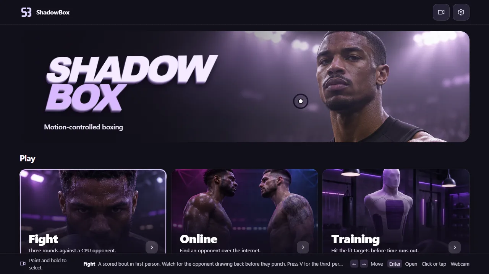
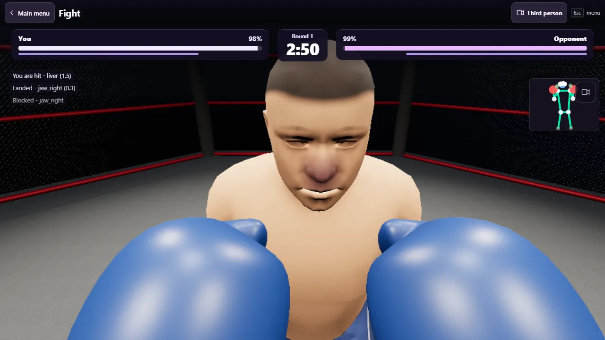
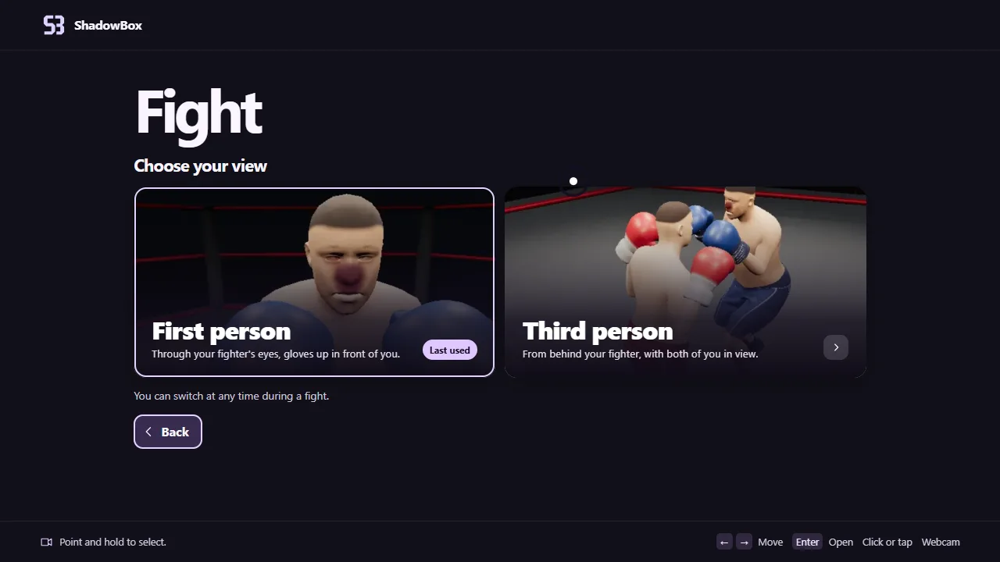
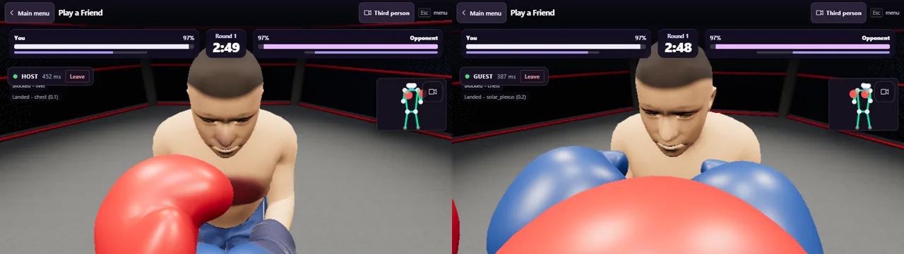
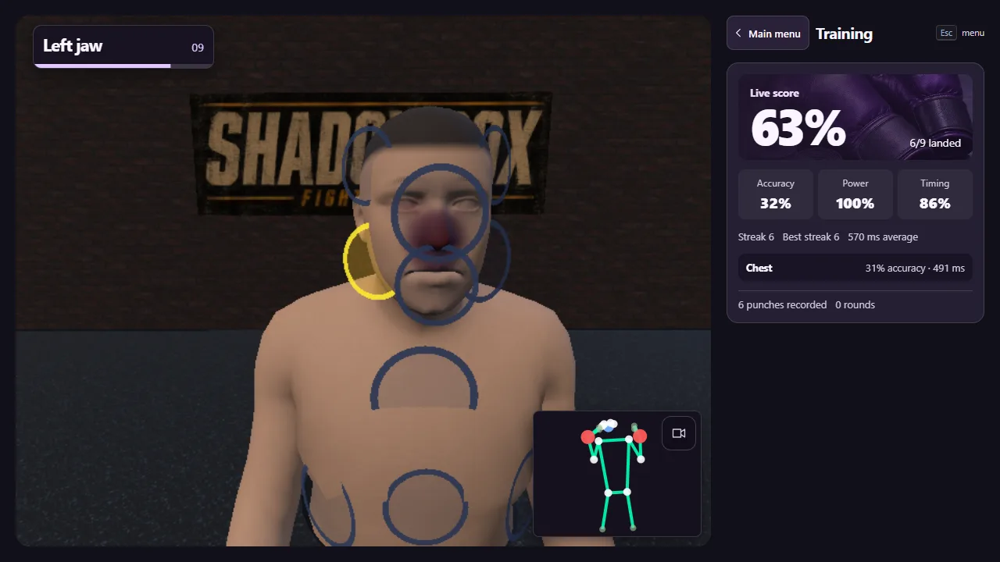

# Gameplay

ShadowBox is played standing up, two to three metres from a webcam, with your
head to your hips in view. Everything in a fight comes from your body: punches,
slips, ducks, your guard and your footwork.

## Modes

| Mode | What it is |
| --- | --- |
| **Fight** | Three three-minute rounds against a CPU opponent, in first person. |
| **Career** | Four opponents in order. Win to advance; a draw or a loss means a rematch. Your record is saved on the device. |
| **Online** | Matchmaking: the server pairs you with the next player in the queue, then the fight runs peer to peer. |
| **Play a Friend** | A private match. The host sends a code, the guest pastes it and sends a reply code back. Works best on the same network. |
| **Training** | A dummy with ten lit target zones, scored on accuracy, power and timing. |
| **Your Fighter** | Skin tone, hairstyle, kit colour, finish, boot laces and soles, glove wraps. Previewed live in 3D and saved for every fight. |
| **Venue** | The cage (a regulation octagon, 30 feet across the flats) or the ring (20 feet inside the ropes). |
| **Camera Check** | What the camera can see: a tracking grade, the weakest landmarks and tips to fix your setup. |

### Career ladder

| # | Opponent | Class | Difficulty | Style |
| --- | --- | --- | --- | --- |
| 1 | The Tune-Up | Welterweight | Rookie | Slow hands, wide guard. |
| 2 | The Swarmer | Lightweight | Contender | Comes forward behind a high guard and keeps punching. |
| 3 | The Boxer-Puncher | Middleweight | Contender | Sound footwork, picks its spots, punishes a lazy guard. |
| 4 | The Champion | Light heavyweight | Champion | Everything, all the time. |

## Controls

### With your body

| Action | How |
| --- | --- |
| Punch | Snap a fist out from your guard to full extension within 450 ms. Arm swings, waves and slow reaches do not count. The hit popup names the punch: straight, hook or uppercut. |
| Guard | Hands up at the chin covers the head; hands at the ribs covers the body. A blocked punch does a fraction of the damage and costs the blocker stamina. |
| Slip | Move your head and shoulders sideways. A slip beats a straight or rising punch, but not a hook, which curves around to where your head went. |
| Duck | Drop your head. A duck gets under any head punch and does nothing about a body shot. |
| Step | Step towards or away from the camera (third-person fights only; in first person the CPU sets the distance). |
| Get up | When knocked down in a CPU fight, hold both gloves up at your face to rise early. |
| Rematch | When a fight ends, raise both hands over your head and hold them there. |
| Menu | Point your hand at a card and hold it still until the ring fills. |

### Keyboard, mouse and touch

| Key | Action |
| --- | --- |
| `Esc` | Back to the menu, from any screen. |
| `V` | Switch the fight camera between first and third person (remembered). |
| Arrows and `Enter` | Move and select in the menu. |
| `` ` `` or `F3` | Developer diagnostics. |

Every on-screen control also works with a tap or a click.

## The fight

- **Choose your view.** Fight, Career, Play a Friend and Online ask for first
  or third person before the match opens, with the view you used last
  focused. Back or `Escape` returns to the menu.

- **Rounds:** three rounds of three minutes.
- **First person.** The default view. The camera is at your fighter's eyes and
  your gloves are at the bottom of the screen. The fighters stay on one line:
  the CPU stands off at its preferred distance between exchanges and steps in
  to throw, then back out, so the fight is about timing, defence and the guard.
- **Third person.** Choose it before the match, press `V`, or turn it on in Settings. The camera sits behind
  your fighter and both fighters move: the CPU circles, steps in to throw and
  backs out again, and your real steps change the range.
- **The CPU telegraphs.** Every CPU punch has a visible wind-up: 0.55 s at
  Rookie, 0.38 s at Contender, 0.26 s at Champion. In first person its gloves
  glow orange through the wind-up. The punch lands when the glove arrives, about
  0.15 s after it leaves the guard, so a slip during the extension still counts.
- **Stamina.** Throwing costs stamina whether or not the punch lands, evading
  costs stamina, and a tired fighter hits softer.
- **Damage** depends on where the punch lands (chin, temple, liver and so on),
  how hard and how directly it was thrown, the attacker's power and the
  defender's chin.
- **Knockdowns.** Health at zero drops a fighter for 2.4 seconds while the
  referee counts. They rise with less health each time. Three knockdowns in a
  round is a TKO. A knockdown plays in slow motion with a camera cut.
- **Fouls.** A punch below the belt costs a point.
- **Scoring.** Each round is scored 10-9 to the fighter who did more damage,
  minus a point per knockdown taken. Close rounds with no knockdowns are even.
  If nobody is stopped, the cards decide.
- **Feedback.** Hit-stop freezes the struck figure for 30 to 90 ms on a power
  shot, the camera kicks, the punch has a recorded sound (head, body, block or
  whiff), the crowd swells on big shots, bruises and swelling appear where the
  punches landed, and a word for each exchange appears on its own row.

## Two players

The host's browser runs the fight. Each player's own camera measures their own
punches and their own defence, so the guest sends its punches and its guard and
head movement to the host, and the host sends back the state of the fight and
every event in it. Both ends see the same result, the same impact words and
hear the same sounds.

The guest's defence arrives one network round trip late, so the host waits up
to that long (30 to 150 ms) before judging its own punch at the guest, and
counts a slip or a block made inside that window.

When the fight ends, both players press "Fight again" (or raise both hands) to
start a rematch on the same connection.

## Training

Targets light up one at a time on the dummy: chin, jaw, temple, chest, solar
plexus, liver and more. You score on accuracy (how close the punch landed to
the target), power and timing (how fast you reacted). The drill learns:
targets you miss come up more often, and a profile separates **setup error**
(the same miss in the same direction on every target, which is the camera's
framing and is corrected for you) from **technique** (what is left).

## Settings

Open Settings from the gear icon on the menu.

| Setting | Default | What it does |
| --- | --- | --- |
| Show my camera | Off | Shows your webcam picture in the corner. Off shows only the tracked skeleton. The camera button on the inset toggles it too. |
| Third-person fights | Off | Fights from behind your fighter instead of through their eyes. |
| Reduce UI motion | Off | Keeps the interface still. Crowd camera flashes follow your system reduced-motion setting. |
| High contrast | Off | Solid backgrounds behind labels. |

## Setting up the camera

- Stand back until your head and hips are both in view. A prompt in the corner
  tells you when the camera cannot see enough of you.
- Light from the front, not from a window behind you.
- On a phone, prop it up at chest height in landscape or portrait; the layout
  adapts to both.
- A first-run walkthrough checks framing, your guard and one punch with each
  hand. Skip it with the button or `Esc`.
