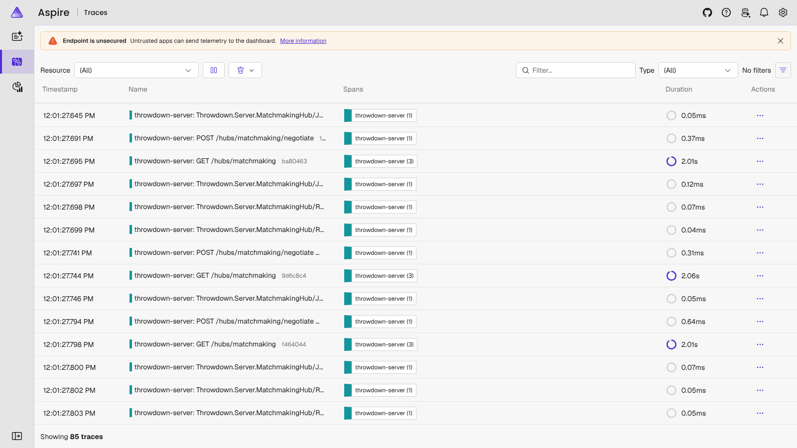

# Live traces (OpenTelemetry + Aspire dashboard)

The server traces every HTTP request and every SignalR hub call
(`JoinQueue`, `RelayOffer`, `RelayAnswer`, ...) with OpenTelemetry. The
.NET Aspire dashboard shows them live, which makes a good on-stage view of
real matches happening.



## Run it locally

```bash
cd server
docker compose up --build
```

- Server: <http://localhost:5160> (`/health`, `/leaderboard`, `/hubs/matchmaking`)
- Dashboard: <http://localhost:18888>, then the **Traces** tab

Point a local game build at this server with
`VITE_MATCHMAKING_URL=http://localhost:5160/hubs/matchmaking`, or generate
traffic with the load test:

```bash
dotnet run --project server/Throwdown.LoadTest -- --players 50
```

The compose file allows browser origins `http://localhost:5174` (dev) and
`http://localhost:4173` (preview).

## How it's wired

| Setting | Effect |
| --- | --- |
| `Telemetry:OtlpEndpoint` | Send traces to an OTLP collector (gRPC). The compose file sets it to the dashboard. |
| `Telemetry:Console` | Print traces to the console instead. On by default in `fly.toml`, so `fly logs` shows them. |

## Security

The compose file runs the dashboard **unsecured** (no login, and it accepts
telemetry from anyone who can reach it). That's fine on a laptop. Don't
publish port 18888 or the OTLP port to the internet. To show traces from the
deployed server, either use `fly logs`, or host the dashboard with its
browser-token login and OTLP API key turned on (see the Aspire dashboard
docs) and set `Telemetry__OtlpEndpoint` on Fly to it.
